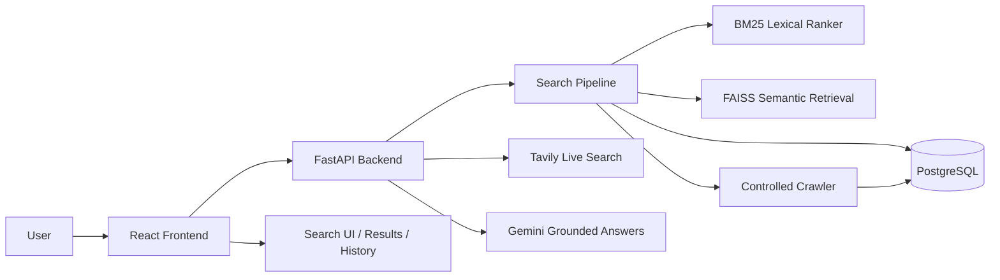

# SEEK — Search Engine for Exploration & Knowledge

[](https://www.python.org/)
[](https://fastapi.tiangolo.com/)
[](https://react.dev/)
[](https://www.postgresql.org/)
[](https://www.docker.com/)
[]()
[](https://github.com/avy2025/SEEK-Search-Engine-for-Exploration-Knowledge/actions)

> A modular, local-first search system for indexing documents, crawling web content responsibly, retrieving results with lexical and semantic ranking, and generating grounded AI answers.

## Why SEEK?

SEEK is designed to be a practical, extensible search stack rather than a thin wrapper around a third-party API. It combines:

- controlled web crawling with rules-aware fetching
- persistent document storage in PostgreSQL
- lexical search with BM25
- semantic retrieval with sentence-transformer embeddings and FAISS
- hybrid ranking for better relevance
- specialized search modes for web, research, code, and AI workflows
- optional grounded answer generation using Tavily + Gemini

This makes it useful as a self-hosted research assistant, internal knowledge search solution, or learning project for modern retrieval systems.

## High-level architecture



## Core capabilities

### Search engine
- BM25-based lexical retrieval over local and crawled documents
- semantic vector search using sentence-transformer embeddings
- hybrid ranking that blends lexical + semantic signals
- mode-aware endpoints such as web, research, AI, and code search

### Web ingestion and indexing
- asynchronous crawler with domain constraints and robots.txt handling
- URL normalization, dedupe, and safe redirect validation
- persistent index rebuild and refresh workflows
- deterministic document storage and change detection

### AI-assisted answers
- optional live internet research with Tavily
- grounded answer synthesis with Gemini using retrieved sources
- citation-aware answer generation and source attribution

### Production-ready deployment patterns
- Docker Compose setup for backend, PostgreSQL, and frontend
- health checks and service orchestration
- persistent data and index volumes for local deployment

## Repository structure

```text
SEEK/
├── backend/
│   ├── ai/
│   ├── api/
│   ├── browser/
│   ├── crawler/
│   ├── db/
│   ├── processing/
│   ├── processor/
│   ├── ranking/
│   ├── search/
│   ├── config.py
│   ├── main.py
│   └── pipeline.py
├── frontend/
│   ├── src/
│   ├── public/
│   ├── package.json
│   └── vite.config.*
├── data/
├── docs/
├── docker/
├── indexes/
├── scripts/
├── tests/
├── .env.example
├── .gitignore
├── alembic.ini
├── docker-compose.yml
├── requirements.txt
└── README.md
```

## Quick start

### 1) Configure environment

Copy the sample environment file and fill in your values:

```bash
cp .env.example .env
```

At minimum, set PostgreSQL and optional API keys for live search/AI answer features:

```bash
POSTGRES_USER=seek
POSTGRES_PASSWORD=your_secure_password
POSTGRES_DB=seek_db
TAVILY_API_KEY=your_tavily_key
GEMINI_API_KEY=your_gemini_key
```

### 2) Start the stack with Docker

```bash
docker compose up --build -d
```

Access points:

- Frontend: http://localhost:3000
- Backend API: http://localhost:8000
- Swagger docs: http://localhost:8000/docs
- ReDoc: http://localhost:8000/redoc

### 3) Verify health

```bash
curl http://localhost:8000/health
```

## Typical workflows

### Local document search

```bash
curl "http://localhost:8000/api/search?q=docker&limit=5"
```

### Research mode

```bash
curl "http://localhost:8000/api/search?q=python%20async%20io&mode=research&limit=10"
```

### Index status and rebuild

```bash
curl http://localhost:8000/api/index/status
curl -X POST http://localhost:8000/api/index/rebuild
```

### Crawl a site

```bash
curl -X POST http://localhost:8000/api/crawl \
  -H "Content-Type: application/json" \
  -d '{
    "urls": ["https://example.com"],
    "allowed_domains": ["example.com"],
    "max_pages": 20,
    "max_depth": 2
  }'
```

## Development setup

### Backend

```bash
python -m venv .venv
source .venv/bin/activate
pip install -r requirements.txt
python -m uvicorn backend.main:app --reload --host 127.0.0.1 --port 8000
```

### Frontend

```bash
cd frontend
npm install
npm run dev
```

## Testing

Run the project checks:

```bash
python -m pytest -q
```

Frontend validation:

```bash
cd frontend
npm run test:frontend
npm run typecheck
npm run build
```

## Documentation

Important project docs are located in the [docs/](docs/) directory:

- [docs/ARCHITECTURE.md](docs/ARCHITECTURE.md)
- [docs/PHASE_16_QA_REPORT.md](docs/PHASE_16_QA_REPORT.md)
- [docs/ROADMAP_TODO.md](docs/ROADMAP_TODO.md)

## Best use cases

- internal knowledge search for technical docs and private corpora
- research workflows that need retrieval + grounded synthesis
- teaching retrieval pipelines and hybrid ranking concepts
- self-hosted search prototypes without vendor lock-in

## License

This project is licensed under the MIT License.

## Project status

The repository is actively structured around a full-stack retrieval system with local indexing, semantic search, controlled crawling, and AI-assisted answers. It is suitable for local experimentation, research, and self-hosted deployment.
